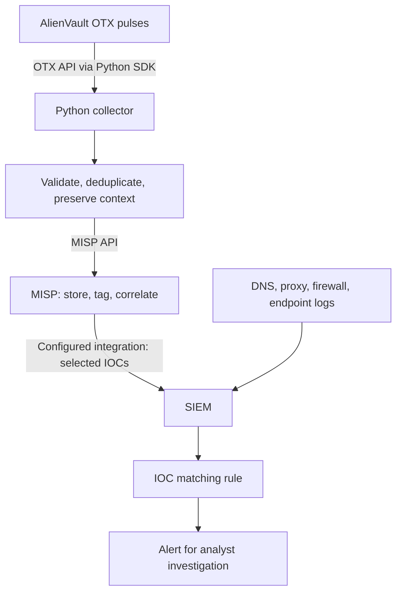

# Automated Threat Intelligence Pipeline

## Overview and status

**Status: Planned.** Collect threat intelligence from AlienVault OTX using Python, manage selected indicators in MISP, and deliver them to a SIEM for IOC matching. No collector, MISP deployment, or SIEM integration is implemented yet.

## Manual problem

SOC analysts spend time collecting indicators from threat reports, checking duplicates, preserving context, and updating SIEM lookups. This project aims to reduce repetitive work and the delay between collecting intelligence and using it for detection. Analysts still assess source quality and investigate matches.

## Inputs and outputs

- Input: OTX pulses from selected subscriptions, including indicators and available references, tags, and timestamps.
- First output: a local JSON file containing five recent subscribed pulses and their indicators.
- Later outputs: new or updated MISP events and selected indicators delivered to the SIEM.
- Preserve pulse IDs, source references, collection time, and available source timestamps.

OTX supplies intelligence published in its pulses; this project does not scrape arbitrary websites.

## Workflow

Example: an OTX domain is collected, stored in MISP, and delivered to a SIEM lookup. A matching DNS event produces an alert for review; a match alone does not establish compromise.

## Technologies and requirements

Planned: Python 3, the OTX Python SDK, JSON storage, MISP API integration, and a scheduler. The SIEM platform and integration method are to be selected.

Use an OTX account, appropriate pulse subscriptions, and an API key supplied through `OTX_API_KEY`. Later phases require MISP access and a configured SIEM integration. Never commit credentials or confidential logs.

## Setup and usage

Implementation has not started. Tested installation and execution instructions will be added with the first working collector.

## Build milestones

1. **Connect:** authenticate to OTX and retrieve one pulse.
2. **Collect:** retrieve five recent subscribed pulses and save titles, references, and indicators to JSON; run manually.
3. **Track changes:** identify pulses by ID and modification timestamp, avoid duplicate records, and process updates.
4. **Schedule:** add recurring execution, logging, error handling, rate-limit handling, and collection summaries.
5. **Integrate MISP:** validate and map indicators, preserve provenance, and create or update events.
6. **Integrate SIEM:** deliver selected indicators, configure matching rules, and verify alerts using synthetic logs.

## Validation

No implementation tests have run. Planned checks cover valid and invalid credentials, empty subscriptions, malformed indicators, duplicate and updated pulses, network/API failures, and safe retries. Later checks will verify MISP mappings and SIEM matches using synthetic data.

## Results

Expected benefits: less manual copying, more consistent context, and faster availability of intelligence for detection. No time savings or detection improvements have been measured.

## Limitations

- Coverage depends on OTX sources and selected subscriptions.
- Community indicators require quality assessment; stale indicators may create noise.
- IOC matching does not detect every attack or prove compromise.
- Scheduled collection requires a running execution environment.
- MISP and SIEM need separate deployment/configuration.
- This project does not automatically block indicators or isolate endpoints.

## Next steps

Build and verify the single-pulse OTX connection first. Add BleepingComputer RSS for news context and ThreatFox as an additional IOC source only after the initial pipeline is stable.
